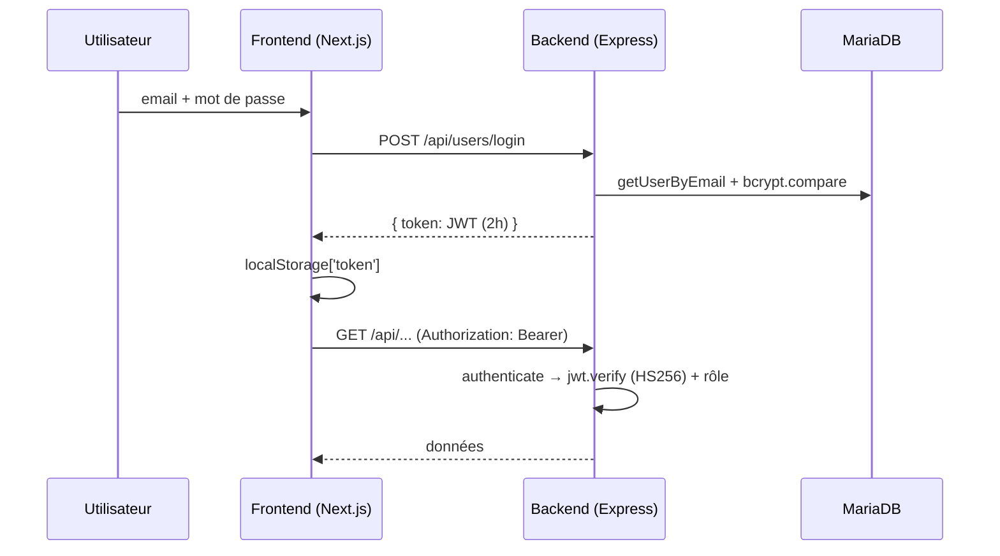

# Architecture — Jean XXIII CRM

CRM pour l'Ensemble Scolaire Jean XXIII : gestion de prospects, templates et
automatisations email, mode Salon (capture de leads), synchronisation L'Express
et webhook WordPress. Un front Next.js, une API Express, une base MariaDB,
orchestrés par Docker Compose derrière un reverse proxy nginx dédié.

## Pile

| Élément | Où |
| --- | --- |
| Next.js 16 (App Router) + React 19 + Tailwind CSS 4 | `frontend/` |
| Express 5 (TypeScript) | `backend/index.ts` |
| MariaDB 10.11 (`mysql2/promise`) | `backend/config/db.ts` |
| Nodemailer | `backend/config/mail.ts` |
| JWT (`jsonwebtoken`) + `bcryptjs` | `backend/middleware/auth.ts`, `routes/userRoutes.ts` |
| Cron (`node-cron`) | automatisations (2 min) + sync L'Express (15 min) |

## Découpage

```
backend/config/      appConfig (FRONTEND_URL), db (pool mysql2), mail (nodemailer)
backend/middleware/  auth.ts (JWT HS256)
backend/routes/      une route Express par ressource (users, prospects, ...)
backend/services/    logique métier + requêtes préparées + audit_logs
backend/utils/       validators (regex email/mot de passe), templateParser
frontend/app/        pages (App Router), composants, contextes, hooks, services
docker-compose.yml   dev (ports hôtes, volumes, hot reload)
docker-compose.prod.yml  prod (réseau interne + proxy-net, aucun port hôte)
```

## Chaîne de démarrage (prod)

```
db ──healthy──▶ backend ──healthy──▶ frontend
```

- `docker-compose.prod.yml` : trois services sur le réseau `internal`
  (`internal: true`, pas de sortie Internet pour la DB) ; backend et frontend
  rejoignent aussi `proxy-net` (réseau externe créé par le dépôt nginx/certbot).
- Le schéma est initialisé au premier démarrage d'un volume vide via
  `dump.sql` (monté en lecture seule). Pas de système de migration : toute
  évolution de schéma passe par une révision de `dump.sql` **avant** le premier
  déploiement d'un volume neuf, ou par un `ALTER` manuel sur l'existant.
- Aucun port hôte en prod : seul nginx (autre compose) expose 80/443 et
  route vers les noms de conteneurs `backend-jeanxxiii-crm-prod` /
  `frontend-jeanxxiii-crm-prod`.

## API et front

- API sous `/api/*` : voir [`api.md`](api.md). `GET /healthz` ping la base
  (200/503), sert de healthcheck Docker.
- Front : App Router, `DashboardWrapper` (sidebar/header/thèmes), garde
  d'authentification côté client (le token JWT vit en `localStorage`, le
  wrapper `api.ts` intercepte les 401 et redirige vers `/login`).
- Mode Salon : verrouillage de l'UI sur `/salons`, sortie par
  ré-authentification (`POST /api/users/reauthenticate`, JWT 6 h).
- Dev : frontend sur `FRONTEND_PORT`, API sur `BACKEND_PORT`,
  `NEXT_PUBLIC_API_URL` pointe le backend (CORS restreint à `FRONTEND_URL`).

## Authentification

JWT HS256 (`JWT_SECRET` ≥ 32 car., validé au démarrage) :



- Rôles : `admin` (utilisateurs, audit, settings, sync complète) et
  `utilisateur` (prospects, statuts, templates, automatisations, formations).
- Réinitialisation : lien email avec token UUID haché en base, expiration 1 h.
- Anti-énumération : hash factice au login, réponse identique au
  forgot-password.

## Automatisations et synchronisation

Deux crons tournent **dans le backend** (`index.ts`) :

| Cron | Fréquence | Rôle |
| --- | --- | --- |
| `processAutomations()` | `*/2` min | envoie les emails d'automatisation (08h–19h, max 3 par règle, dedup via `email_automation_logs`) |
| `syncLatestLexpressSubmissionsToDb()` | `*/15` min | sync incrémentale des 50 dernières soumissions L'Express |

Le webhook WordPress (`POST /api/webhooks/wordpress`) fait un upsert par email,
protégé par `x-webhook-secret` (comparaison en temps constant).

## Limites connues

- Token JWT en `localStorage` : exposition au XSS (voir `security.md`).
- Pas de système de migration versionnée : `dump.sql` = schéma initial seul.
- Les fichiers `docs/` font foi ; un README de paquet peut décrire un état
  antérieur.
